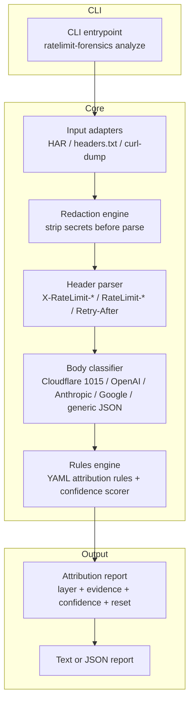

# TECHNICAL — ratelimit-forensics

## Architecture (C4 containers, Mermaid)



This document describes the implemented v0.1 behaviour. SARIF export and HAR
streaming appear only as unchecked roadmap items.

## Data model

### Input: captured 429
- Headers: key-value map (case-insensitive)
- Body: text/bytes (classified by pattern)
- Optional: one access-log line (tiebreaker)

### Attribution rule (YAML, rules-as-data)
```yaml
- id: cloudflare-edge-absence
  when:
    status: 429
    headers_absent: [RateLimit-Limit, RateLimit-Remaining, X-RateLimit-Limit]
    body_matches: cloudflare-error-1015
  then:
    layer: edge-cdn
    vendor: cloudflare
    confidence: 0.92
    evidence:
      - "body matches Cloudflare error 1015"
      - "RateLimit-* headers absent (Cloudflare edge 429s typically carry no counters)"
```

### Output: attribution report
```json
{
  "layer": "edge-cdn",
  "vendor": "cloudflare",
  "confidence": 0.92,
  "evidence": ["...", "..."],
  "policy": null,
  "window": {"reset": 30, "unit": "delta-seconds", "source": "Retry-After"},
  "conflicts": ["app-layer RateLimit-Remaining: 1757 contradicts edge 429"],
  "insufficient_evidence": false
}
```

## Public interfaces

- CLI: `ratelimit-forensics analyze --har|--headers|--curl-dump|--stdin [--json] [--rules PATH] [--log-line TEXT]`
- Python API: `from ratelimit_forensics import evaluate, load_rules`; load the
  packaged or custom rules, then evaluate a status, headers mapping and body.
- There is no Node API in v0.1.

## Error model

- Exit 0: attribution produced (any confidence, including "insufficient evidence")
- Exit 2: input unparseable (bad HAR, missing headers)
- Exit 3: redaction failure (secret detected but could not strip)
- Never: wrong confident verdict — ambiguous → `insufficient_evidence: true`

## Configuration model

- Rules: packaged `rules/default.yaml`, replaced or extended with the CLI
  `--rules FILE_OR_DIR` option; there is no implicit user config directory.
- Redaction patterns are built in; v0.1 does not accept user-supplied
  redaction regexes.
- No network calls, ever (offline-first).

## Performance budget

- 10k-line HAR analyzed in <2s on the fixture suite.
- The v0.1 parser reads the input into memory. HAR streaming and an explicit
  large-file cap remain roadmap work; do not feed it untrusted multi-gigabyte
  captures.

## Threat model (STRIDE-lite)

- **Tampering**: rules-as-data could be tampered. v0.1 ships unsigned packaged
  rules; distribute and review custom rules like code. Signed rules remain
  roadmap work.
- **Information disclosure**: logs may contain API keys → redaction runs before
  parsing and the rendered report is leak-checked before printing.
- **Denial of service**: no network listener, but a hostile local file can
  consume memory; streaming and explicit caps remain roadmap work.
- **Elevation**: none (no network, no privileges).

## Privacy model

- Zero telemetry, zero network
- Redaction of secrets from all outputs by default
- Local-only processing

## Testing strategy (verification ladder)

- **L1 Unit**: each parser (X-RateLimit, RateLimit draft-8, Retry-After delta vs HTTP-date, OpenAI dual-dim, Anthropic), each body classifier, redaction patterns, confidence scorer
- **L2 Integration**: synthetic 429 fixtures from local Express/Flask/nginx/Envoy + mocklimit provider templates (MIT, vendored with attribution); full analyze pipeline
- **L4 Clean environment**: Docs-verifier follows README from fresh clone
- **L5 Adversarial**: malformed headers, HTTP-date Retry-After, conflicting status/header/body (tianpan.co pattern), huge HAR, secret-in-log redaction, ambiguous "insufficient evidence" cases

## Tech choices

- **Python 3.10+**, standard library plus PyYAML for rules-as-data.
  - Rejected: Go (no host toolchain), Node (secondary target later), Rust (no host toolchain)
- Testing: pytest with unit, integration, adversarial and CLI tests.
- Rationale: contributor-friendly and easy to run fully offline.

## Repository layout

```
ratelimit-forensics/
├── AGENTS.md
├── README.md
├── LICENSE (MIT)
├── pyproject.toml
├── src/ratelimit_forensics/
│   ├── __init__.py
│   ├── adapters.py        # HAR, header block and curl-dump parsing
│   ├── bodies.py          # body classifiers
│   ├── cli.py
│   ├── models.py
│   ├── parsers.py         # rate-limit and Retry-After parsing
│   ├── redact.py
│   ├── report.py
│   ├── rules.py
│   └── rules/default.yaml
├── tests/ (unit/, integration/, adversarial/, fixtures/)
└── docs/ (PRODUCT.md, TECHNICAL.md, ROADMAP.md, EVIDENCE.md, SECURITY in root)
```

## Coding conventions

- Python: type hints, ruff lint, pytest; rules-as-data (no hardcoded attribution in Python)
- Every README snippet = doc-test in CI
- Conventional Commits
